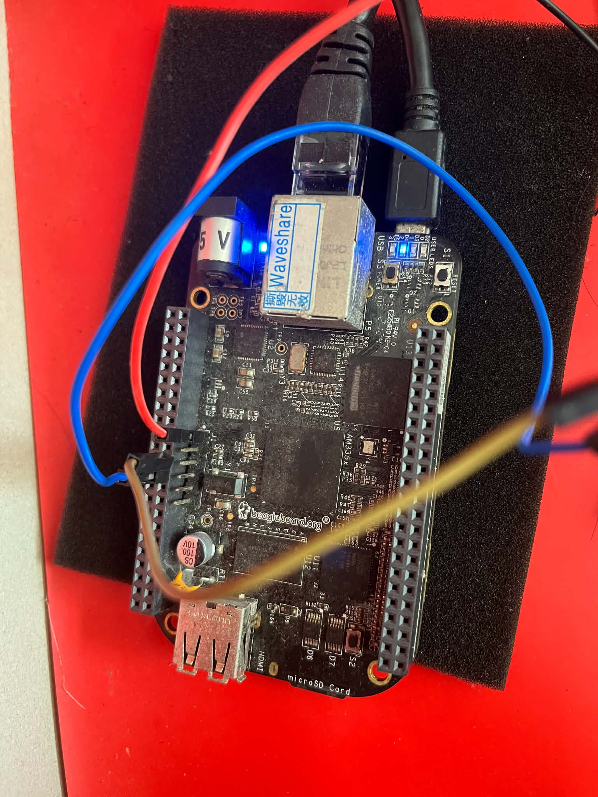
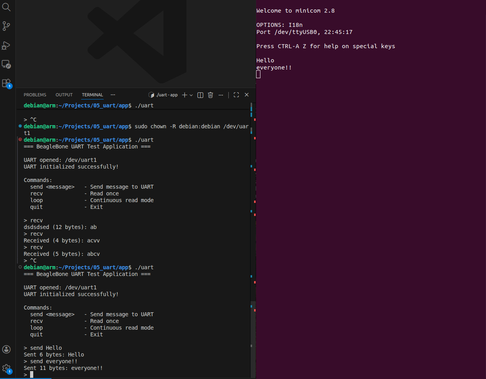
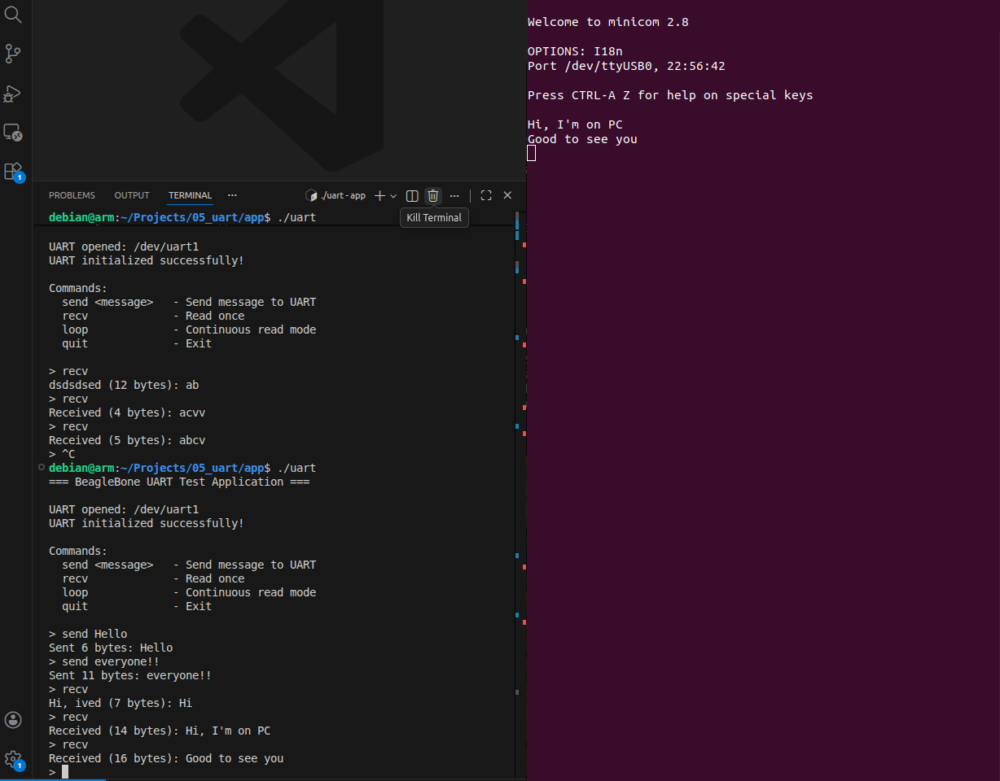

# BBB UART Driver
UART communication between the BeagleBone Black (BBB) and a PC using Minicom.

## UART Pin Configuration
- **P9_26**: UART1_RXD
- **P9_24**: UART1_TXD

Connect the BBB UART pins to the corresponding RX/TX pins on the USB-to-UART adapter, and connect GND between the devices.

## Setup
1. Build and load the kernel driver in `kernel/`.
2. Build the C++ application in `application/`.
3. Connect the BBB to the PC using a USB-to-UART adapter.

## Testing
- On PC, run 'minicom -D /dev/ttyUSBX -b <baundrate>'
- On BBB, build and run main.cpp 

## Testing
- Connect TX pin (yellow wire) and RX pin (blue wire) on BBB to USB-to-UART adapter

## Output
- Uart for sending data to PC:

- Uart for reading data from PC:

