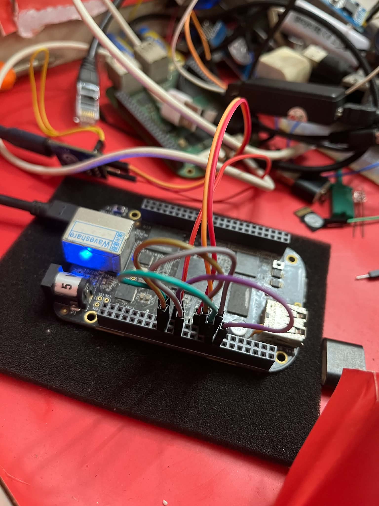
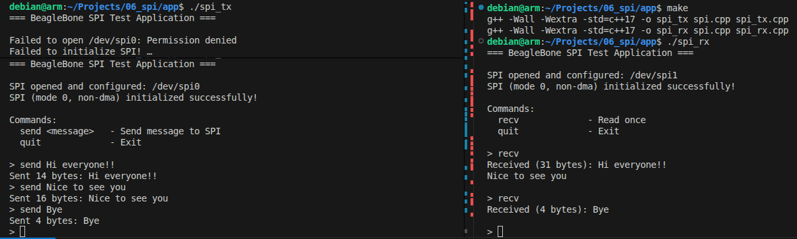
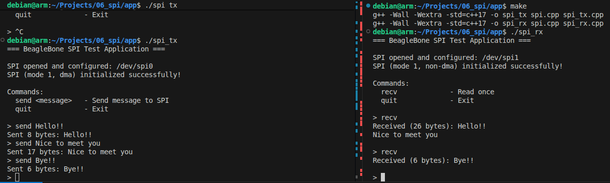
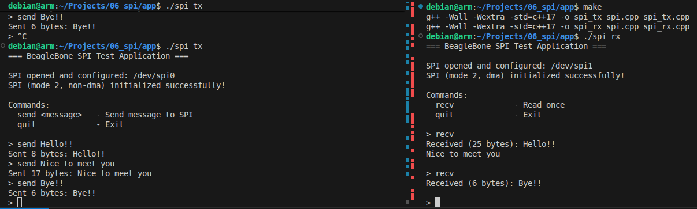

# BBB SPI Driver

SPI data transfer between the master controller **SPI0** and the slave/receiver controller **SPI1** on the same BeagleBone Black (BBB) board. The project includes kernel drivers for SPI0 TX and SPI1 RX, with optional DMA and debug output.

## SPI Pin Configuration

Connect the SPI0 master pins to the corresponding SPI1 slave pins on the **same BBB board**:

| Controller | BBB header pin | Signal | Direction / role |
|---|---|---|---|
| SPI0 TX (master) | P9_17 | `spi0_cs0` | Chip select |
| SPI0 TX (master) | P9_21 | `spi0_d0` (MISO) | SPI0 data input |
| SPI0 TX (master) | P9_18 | `spi0_d1` (MOSI) | SPI0 data output |
| SPI0 TX (master) | P9_22 | `spi0_sclk` | SPI clock output |
| SPI1 RX (slave) | P9_28 | `spi1_cs0` | Chip select |
| SPI1 RX (slave) | P9_29 | `spi1_d0` (MISO) | SPI1 data output |
| SPI1 RX (slave) | P9_30 | `spi1_d1` (MOSI) | SPI1 data input |
| SPI1 RX (slave) | P9_31 | `spi1_sclk` | SPI clock input |

Wire the signals between the controllers according to their roles: SPI0 MOSI (`P9_18`) to SPI1 data input (`P9_30`), SPI0 SCLK (`P9_22`) to SPI1 SCLK (`P9_31`), and SPI0 chip select (`P9_17`) to SPI1 chip select (`P9_28`) if the configured driver setup uses that connection. Connect SPI0 MISO (`P9_21`) to SPI1 data output (`P9_29`) only if the return-data path is required. Ensure the pin mux/device tree is configured for these SPI signals.

- Connect CS pin (yellow wire), MOSI pin (green wire), MISO pin (white wire) and CLK pin (purple wire) 


## Setup

1. Configure the BBB pin multiplexing/device tree for SPI0 and SPI1 as required by the drivers.
2. Build and load the SPI0 TX and SPI1 RX kernel drivers from `kernel/`.
3. Build the test applications in `application/` using `make`.
4. Confirm that `/dev/spi0` and `/dev/spi1` exist and that you have permission to access them. Use `sudo` where required.

## Testing

1. Start the receiver first:

   ```bash
   ./spi_rx
   ```

2. Start the transmitter in another terminal:

   ```bash
   ./spi_tx
   ```

3. Select the same SPI mode on both applications. The test output demonstrates modes 0–3 and both non-DMA and DMA configurations.
4. At the transmitter prompt, send a message using:

   ```text
   send <message>
   ```

## DMA / FIFO Configuration Notes

The available TX/RX combinations have the following known constraints when both SPI controllers run on the same BBB board:

| SPI0 TX mode | SPI1 RX mode | `FIFO_DRAINED` |
|---|---|---|
| Non-DMA | Non-DMA | Do not use |
| DMA | Non-DMA | Should be enabled |
| Non-DMA | DMA | Verify with the current driver configuration |
| DMA | DMA | Verify with the current driver configuration |

The behavior of the last two combinations is not specified here; validate them on the target board before relying on them. `DMA_USED_TX` controls the TX mode and `DMA_USED_RX` controls the RX mode. `FIFO_DRAINED` is an RX-side option for handling the FIFO under the noted same-board timing constraints.

## Output

Test output should show the transmitted message on the TX side and the corresponding received message and byte count on the RX side. The screenshots can be added here when available.

- SPI for mode 0, non-dma:


- SPI for mode 1, dma on TX master and non-dma on RX slave:


- SPI for mode 2, non-dma on TX master and dma on RX slave:


- SPI for mode 3, dma:

