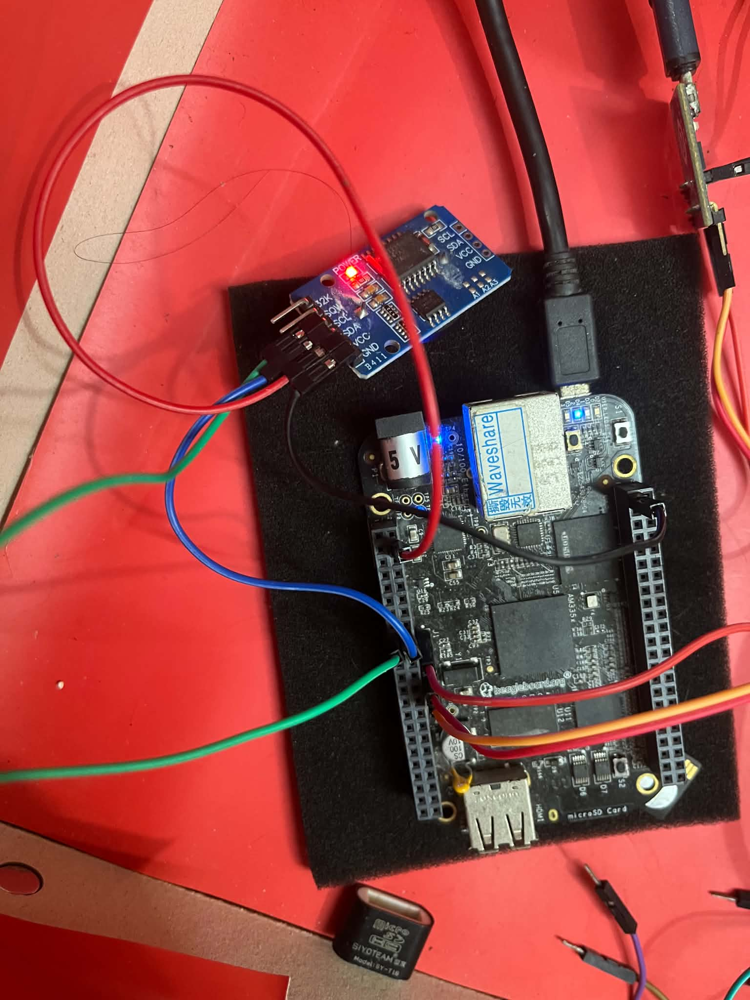
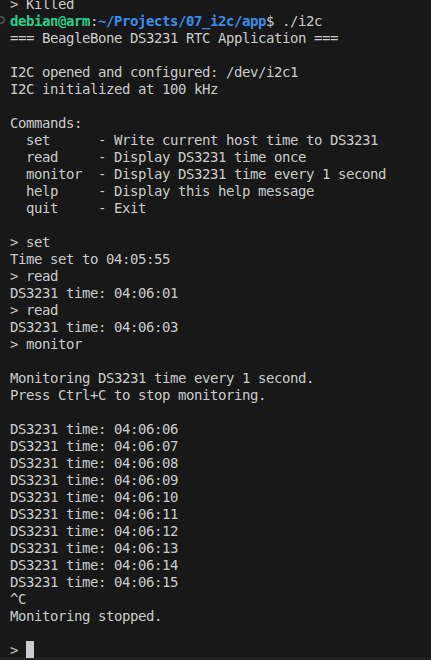
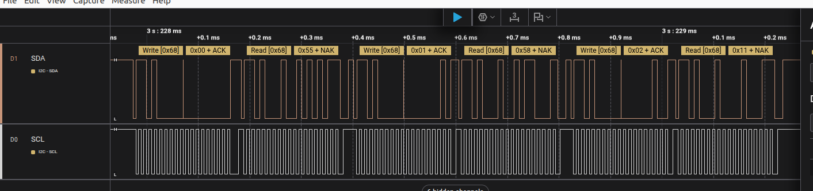

# BBB I2C Driver

I2C communication between the BeagleBone Black (BBB) and a DS3231 RTC module using the custom I2C1 kernel driver and C++ application.

## I2C Pin Configuration

| BBB header pin | Signal | Role |
|---|---|---|
| P9_17 | `i2c1_scl` | I2C clock |
| P9_18 | `i2c1_sda` | I2C data |

Connect the BBB I2C1 pins to the corresponding SCL and SDA pins on the DS3231 module. Connect GND between the BBB and the module, and ensure the I2C voltage levels are compatible.

## Setup

1. Configure the BBB pin multiplexing/device tree for I2C1 as required by the driver.
2. Build and load the I2C1 kernel driver from `kernel/`.
3. Build the application in `application/` using `make`.
4. Confirm that `/dev/i2c1` exists and that you have permission to access it. Use `sudo` where required.

- Connect SCL pin (green wire) and SDA pin (blue wire) to pins on DS3231 


## Testing

1. Run the application from the `application/` directory:

   ```bash
   ./i2c
   ```

2. Use the interactive commands:

   ```text
   set      - Write the current host time to the DS3231
   read     - Display the DS3231 time once
   monitor  - Display the DS3231 time every 1 second
   help     - Display available commands
   quit     - Exit the application
   ```

3. While `monitor` is running, press `Ctrl+C` to stop monitoring and return to the command prompt.

## Output

The application reports whether time-setting succeeds and displays the time read from the DS3231. In monitor mode, it prints the RTC time repeatedly at approximately one-second intervals.

- Set time, Read time, Monitor time:

  
- Logic analyzer:


