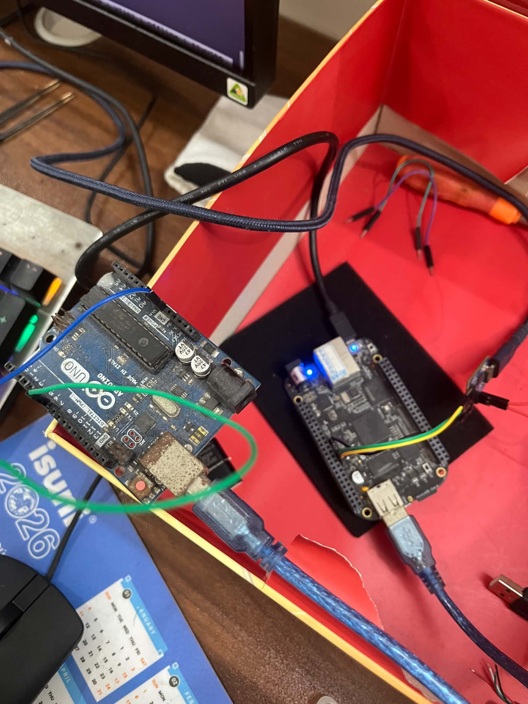
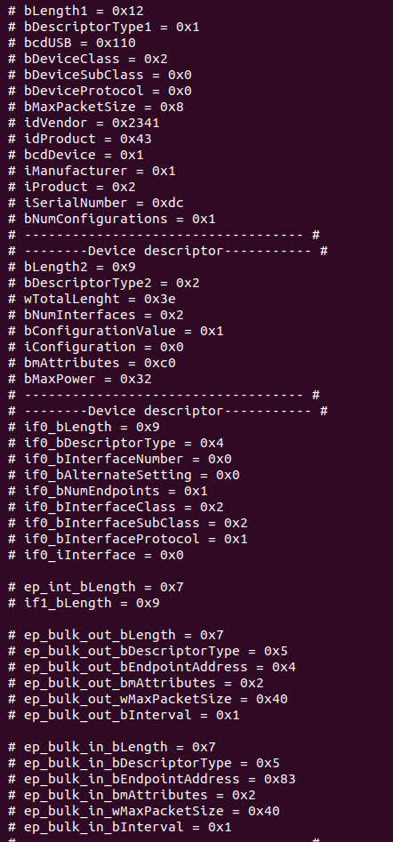
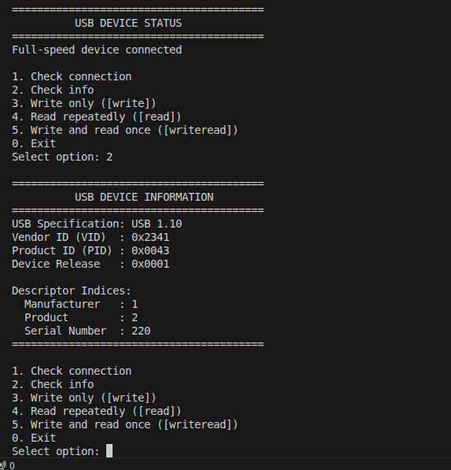
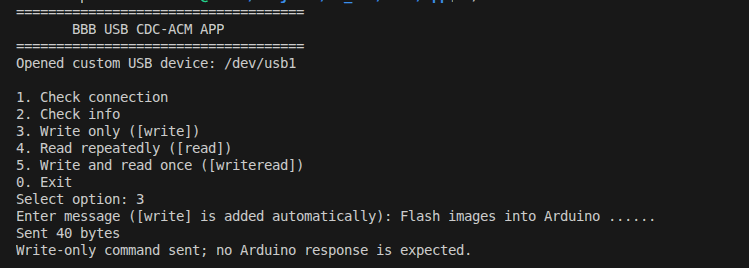
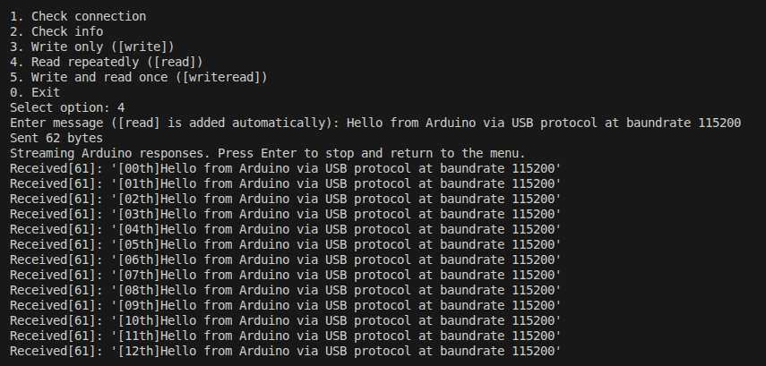
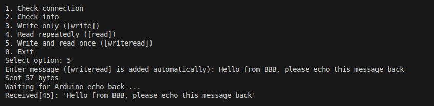

# BBB USB CDC Driver

USB CDC communication between a BeagleBone Black (BBB), acting as the USB host, and an Arduino, acting as the USB CDC device. The project contains a custom Linux kernel driver that exposes the device through `/dev/usb1` and a C++ userspace application for connection checks, device information, and data-transfer tests.

## Setup

1. Connect the Arduino to the BBB USB host port used by the custom USB1 driver.
2. Configure and build the custom USB1 kernel driver from the kernel project.
3. Load the driver and confirm that `/dev/usb1` exists.
4. Build the userspace application:

   ```bash
   make
   ```

5. Confirm that the current user has permission to access `/dev/usb1`. Use `sudo` where required.
6. Upload the USB CDC responder sketch to the Arduino. Messages should be newline-terminated (`\n`).

## Testing

Run the application on the BBB:

```bash
./cdc_usb_app
```

Choose an option from the menu. The option numbers below correspond to the USB CDC application menu in `main.cpp`.

Connection:



Descriptor information grom Arduino device:



## Menu Options and Output

### Option 1 — Check connection

Checks whether the Arduino USB CDC device is connected and configured.

### Option 2 — Check device information

Displays the USB device information reported by the driver, including available descriptor fields.

The connection and device-information output is shown in the screenshot for options 1 and 2:



### Option 3 — Write (`[write]`)

Sends a message prefixed with `[write]`. The Arduino receives the message but does not send a response.



### Option 4 — Read (`[read]`)

Sends a message prefixed with `[read]`. The Arduino sends the message back once per second, with an index from `[00th]` to `[99th]`, then wraps around to `[00th]`. Repeating stops when another command is received. The application should continue reading until the user stops the read operation, as implemented by the userspace application.



### Option 5 — Write and read (`[writeread]`)

Sends a message prefixed with `[writeread]`. The Arduino echoes the message once, and the application displays the response.



## Expected Behavior

- **Option 1:** reports the connection status.
- **Option 2:** displays device information.
- **Option 3:** sends a message without expecting a response.
- **Option 4:** receives indexed responses at one-second intervals.
- **Option 5:** sends a message and receives one echo response.

## Notes

- The userspace application and Arduino sketch must agree on the command prefixes: `[write]`, `[read]`, and `[writeread]`.
- Use newline-terminated commands so the Arduino can identify the end of each command.
- If the device node is not `/dev/usb1`, update the device path in the userspace source before building.
