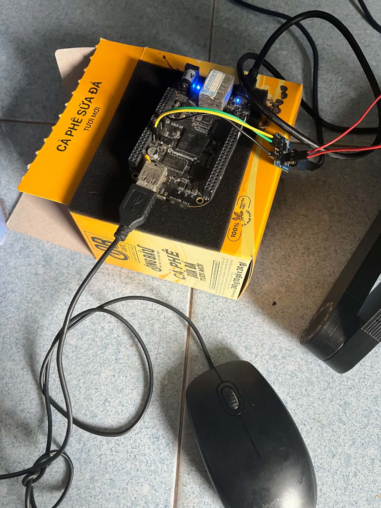
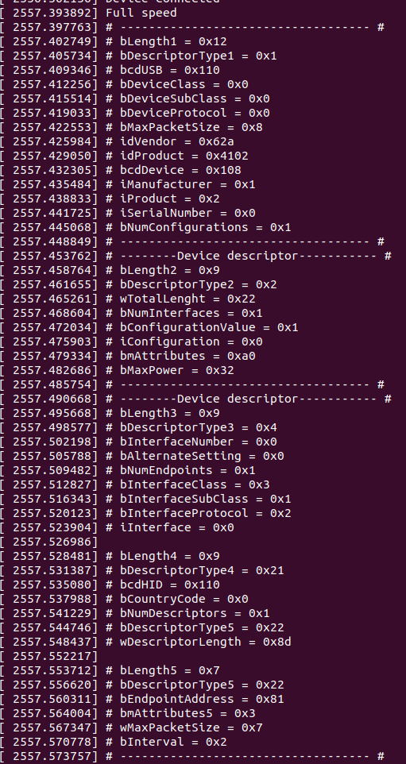
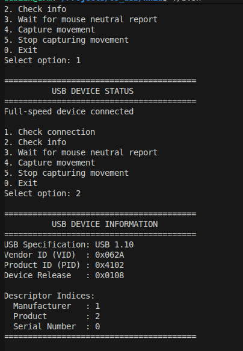
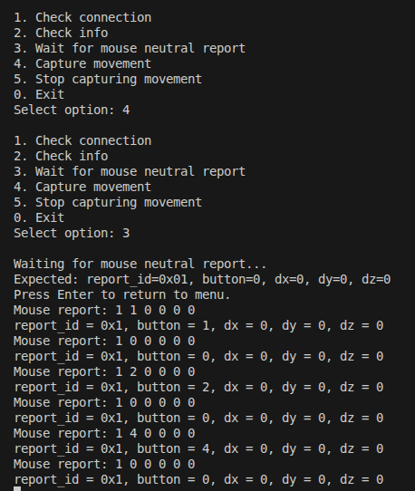
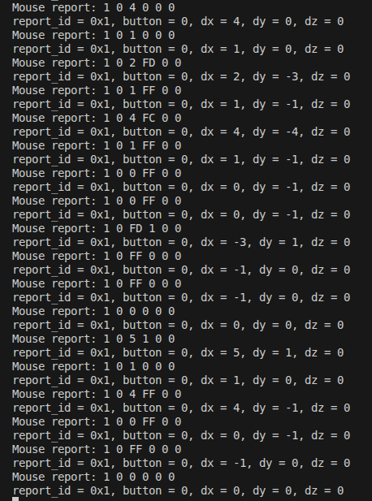
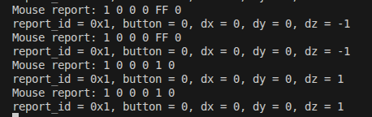

# BBB USB HID Driver

USB HID mouse communication between a BeagleBone Black (BBB), acting as
the USB host, and a USB HID mouse. The project contains a custom Linux
kernel driver that exposes the device through `/dev/usb1` and a C++
userspace application for checking the connection, reading device
information, and monitoring mouse reports.

## Setup

1.  Connect the USB HID mouse to the BBB USB host port used by the
    custom USB1 driver.

2.  Configure and build the custom USB1 kernel driver from the kernel
    project.

3.  Load the driver and confirm that `/dev/usb1` exists.

4.  Build the userspace application:

    ``` bash
    make
    ```

5.  Confirm that the current user has permission to access `/dev/usb1`.
    Use `sudo` where required.

6.  Ensure the kernel driver is capturing mouse reports before using the
    report-viewing option.
    
Connection:



Descriptor on kernel:



## Testing

Run the application on the BBB:

``` bash
./main
```

The menu should look similar to this:

``` text
1. Check connection
2. Check info
3. Wait for mouse neutral report
4. Capture movement
5. Stop capturing movement
0. Exit
```

## Menu Options

### Option 1 --- Check connection

Checks whether the USB HID device is connected and configured.

### Option 2 --- Check device information

Displays the USB device information reported by the driver, such as USB
version, vendor ID, product ID, device version, and available
string-descriptor indices.

The connection and device-information output is shown in the screenshot for options 1 and 2:



### Option 3 --- Wait for mouse neutral report

Waits until the application receives the expected six-byte neutral mouse
report:

``` text
report_id = 0x01, button = 0, dx = 0, dy = 0, dz = 0
```

The application displays each mouse report while waiting. Press
**Enter** to return to the menu before a neutral report is detected.

**Important:** Option 3 only reads and displays reports that the kernel
driver makes available. It does not start capture by itself. Choose
**Option 4** first to start capturing movement; otherwise, no reports
may be available to display.

Click button (button value):



Movement (dx/dy value):



Roll (dz value):



### Option 4 --- Capture movement

Starts mouse-report capture in the kernel driver. Use this option before
Option 3 when you want to observe mouse reports.

### Option 5 --- Stop capturing movement

Stops mouse-report capture in the kernel driver. After capture is
stopped, Option 3 will not receive new reports until capture is started
again with Option 4.

### Option 0 --- Exit

Exits the userspace application and closes the device.

## Recommended workflow

1.  Choose **Option 1** to verify that the mouse is connected.
2.  Choose **Option 2** to inspect the device information.
3.  Choose **Option 4** to start capturing movement.
4.  Choose **Option 3** to view reports and wait for the neutral report.
    Move or release the mouse as needed. Press **Enter** to return to
    the menu.
5.  Choose **Option 5** when you no longer want to capture movement.
6.  Choose **Option 0** to exit.

## Expected mouse report format

The application expects six-byte reports, for example:

``` text
01 04 00 00 FF 00
01 00 00 00 00 00
```

The fields interpreted by the application are:

-   Byte 0: report ID
-   Byte 1: button state
-   Byte 2: horizontal movement (`dx`), interpreted as signed 8-bit
-   Byte 3: vertical movement (`dy`), interpreted as signed 8-bit
-   Byte 4: wheel movement (`dz`), interpreted as signed 8-bit
-   Byte 5: additional byte displayed for diagnostics

The neutral report condition is report ID `0x01`, button state `0`, and
`dx`, `dy`, and `dz` all equal to `0`.

## Notes and troubleshooting

-   The application and kernel driver must agree on the `/dev/usb1`
    device node and the mouse report format.
-   Start capture with **Option 4** before expecting reports in **Option
    3**.
-   Stop capture with **Option 5** when you want the driver to stop
    reporting movement.
-   If the device node is not `/dev/usb1`, update the device path in the
    userspace source before building.
-   If no reports appear, verify the connection, confirm that capture is
    enabled, and check the kernel log for USB or driver errors.
-   This README describes the userspace menu behavior; ioctl command
    definitions and capture-state behavior must match the implementation
    in the kernel driver.
