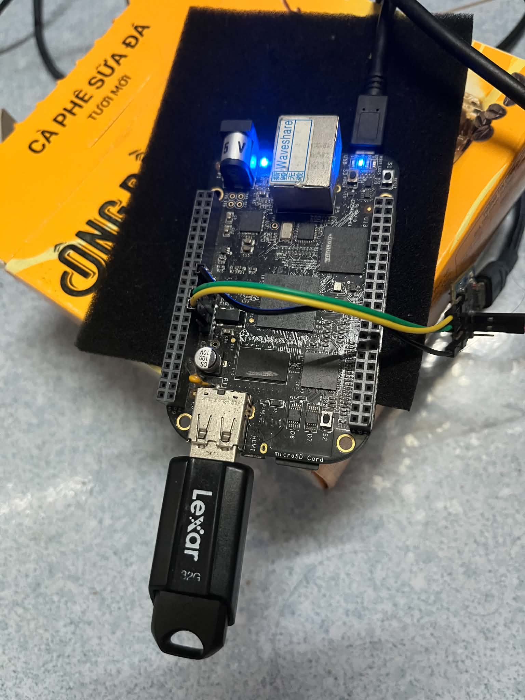
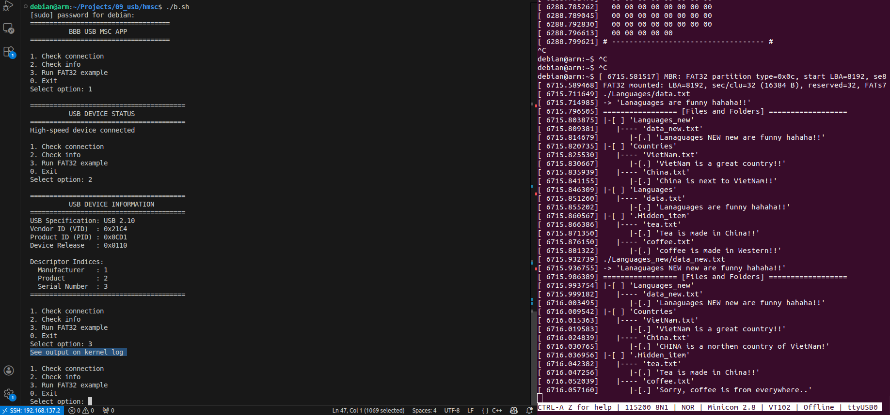
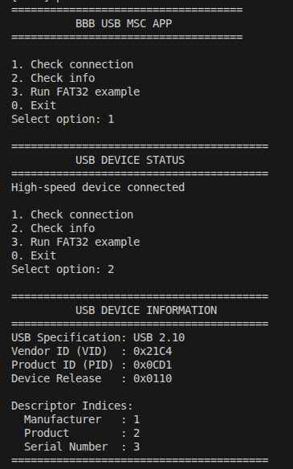
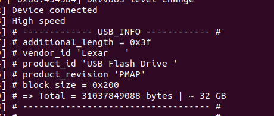
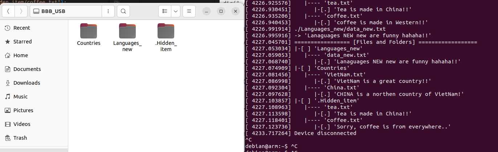
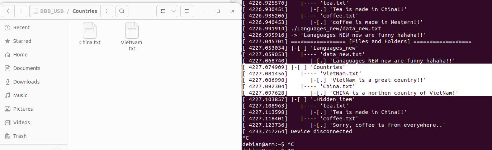
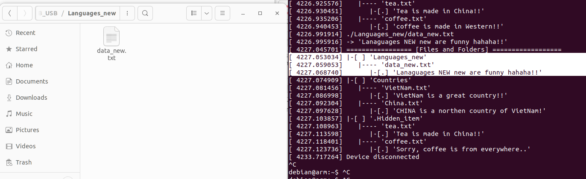
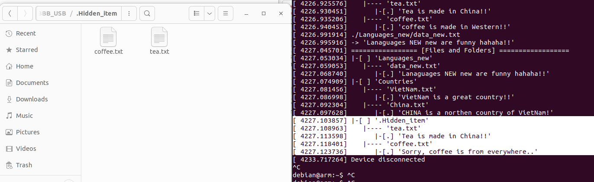

# BBB USB Mass Storage (MSC) Driver

USB Mass Storage Class (MSC) communication between a BeagleBone Black (BBB), acting as the USB host, and a USB flash drive. The project contains a custom Linux USB1 kernel driver exposed through `/dev/usb1` and a C++ userspace application for checking the connection, reading device information, and running FAT32 file-and-directory tests.

## Setup

1. Connect a USB MSC flash drive to the BBB USB host port used by the custom USB1 driver.
2. Configure and build the custom USB1 kernel driver from the kernel project.
3. Load the driver and confirm that `/dev/usb1` exists.
4. Build the userspace application from the project directory:

   ```bash
   make
   ```

5. Confirm that the current user has permission to access `/dev/usb1`. Use `sudo` where required. The launch script shown in the test screenshots is `./b.sh`.
6. Use a test USB drive with a FAT32 volume. The FAT32 example writes to the drive, so back up important data before running it.

## Hardware Connection

The photo shows the BBB connected to a Lexar USB flash drive through the USB host port.



## Testing

From the project directory on the BBB, launch the userspace application. The workflow shown in the screenshots uses:

```bash
./b.sh
```

The application menu is:

```text
1. Check connection
2. Check info
3. Run FAT32 example
0. Exit
```

The menu is shown in the screenshot below, alongside the kernel output from the FAT32 test:



## Menu Options and Output

### Option 1 — Check connection

Checks whether the USB MSC device is connected and configured. A successful check is shown as:

```text
USB DEVICE STATUS
High-speed device connected
```

### Option 2 — Check device information

Displays the USB device information reported by the driver, including USB specification, vendor ID, product ID, device release, and string-descriptor indices.

The captured output for options 1 and 2 is shown here:



The kernel log can also show the device's inquiry information. In this example, the connected drive reports vendor `Lexar`, product `USB Flash Drive`, revision `PMAP`, 512-byte blocks, and an approximate capacity of 32 GB. These values depend on the connected device.



### Option 3 — Run FAT32 example

Runs the FAT32 test routine. The captured kernel output shows the driver detecting a FAT32 partition, mounting the volume, and exercising file and directory operations. The test output includes nested directories, text files, file contents, and a hidden directory named `.Hidden_item`.

The recursive directory listing from the example includes entries such as:

```text
Countries/
    VietNam.txt
    China.txt
Languages_new/
    data_new.txt
.Hidden_item/
    tea.txt
    coffee.txt
```

The example output is printed in the kernel log/serial console. The precise output depends on the state and contents of the USB drive.

### Verify the resulting files and directories

The screenshots below show the files visible in the drive after running the example.

**All folders at the volume root**



**Countries directory**



**Languages_new directory**



**Hidden directory**



## Recommended Workflow

1. Connect a FAT32-formatted USB flash drive to the BBB USB host port.
2. Load the custom USB1 kernel driver and verify that `/dev/usb1` exists.
3. Run `./b.sh` and choose **Option 1** to check the connection.
4. Choose **Option 2** to inspect the device information.
5. Back up any important data, then choose **Option 3** to run the FAT32 example.
6. Review the kernel log or serial console for mount and file-operation output.
7. After the test has completed and the drive is no longer being accessed, disconnect it from the BBB and inspect the resulting files on a PC if needed.
8. Choose **Option 0** to exit the userspace application.

## Notes and Troubleshooting

- The userspace application and kernel driver must agree on the `/dev/usb1` device node and ioctl interface.
- The FAT32 example writes to the USB drive. Do not run it on a drive containing important data unless that data is backed up.
- If the device is not detected, check the physical connection, driver state, `/dev/usb1`, and the kernel log.
- If device information is missing, check the USB MSC inquiry/descriptor handling and the kernel log.
- The FAT32 output depends on the drive's partition layout and existing files. The screenshots document one successful test setup, not a guarantee that every drive will produce identical output.
- The examples shown here use the Lexar USB flash drive pictured above; different MSC devices may report different IDs, product names, capacities, and revisions.
