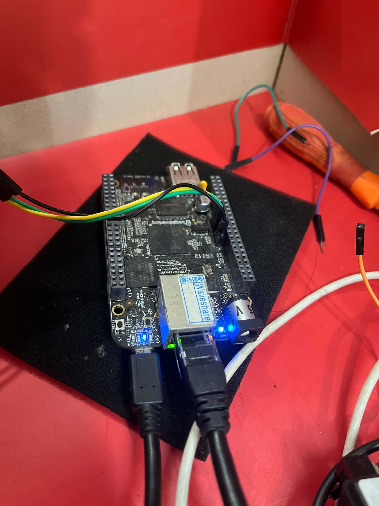
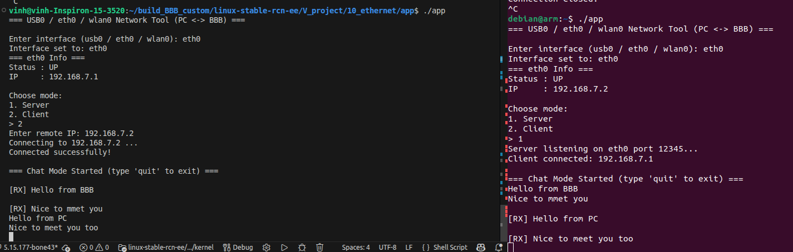
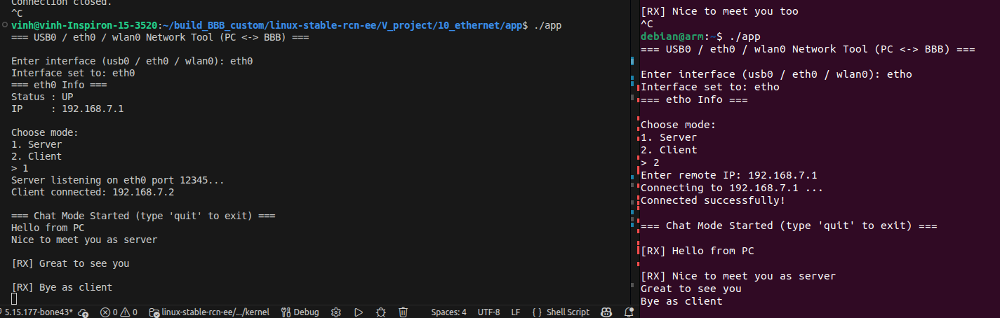

# BBB Ethernet Network Tool

A simple TCP chat application for testing Ethernet communication between a BeagleBone Black (BBB) and a Linux PC. Both devices run `./app`; one acts as the TCP server and the other as the client. The application uses the selected network interface (for this setup, `eth0`) and TCP port `12345`.

## Hardware connection

Connect the BBB Ethernet port directly to the PC Ethernet port using an Ethernet cable, or connect both devices to the same Ethernet network. The screenshots in this README show a direct wired connection.



## Network configuration

Use static IPv4 addresses on the same subnet for a direct connection:

| Device | Interface | IPv4 address | Prefix |
|---|---|---:|---:|
| PC | `eth0` | `192.168.7.1` | `/24` |
| BBB | `eth0` | `192.168.7.2` | `/24` |

### 1. Configure the BBB

Load the custom Ethernet kernel module from the directory containing the built module. Replace `eth0.ko` if your actual module filename differs:

```bash
sudo insmod ./eth0.ko
```

Assign the BBB address and bring the interface up:

```bash
sudo ip addr add 192.168.7.2/24 dev eth0
sudo ip link set eth0 up
```

If the address is already configured, `ip addr add` may report that it already exists. Inspect the interface first with `ip addr show eth0`; remove an old address if needed before adding the new one.

### 2. Configure the PC

First identify the wired interface:

```bash
ip -br link
ip addr
```

If the interface is named `enxc817f53ec9ad`, you can either use that name in the commands below and select it when running the application, or rename it to `eth0` while it is down:

```bash
sudo ip link set enxc817f53ec9ad down
sudo ip link set enxc817f53ec9ad name eth0
```

Renaming is optional. Do not rename the interface over a remote SSH session that depends on it; that can disconnect the session. To use `eth0`, assign the PC address and bring the interface up:

```bash
sudo ip addr add 192.168.7.1/24 dev eth0
sudo ip link set eth0 up
```

If you keep the original interface name, substitute it for `eth0` in the address and link commands and select that interface in the app. If an IP address is already configured, inspect it with `ip addr show <interface>` before adding another address.

### 3. Verify connectivity

Check both interface addresses and link state:

```bash
ip -br addr show eth0
```

From the PC, test the BBB address:

```bash
ping 192.168.7.2
```

From the BBB, test the PC address:

```bash
ping 192.168.7.1
```

If ping fails, verify the cable, interface names, link state, IP addresses, subnet masks, and firewall rules before testing the application.

## Build and run

Build the userspace application in the project directory on both devices:

```bash
make
```

Run it on both the PC and BBB:

```bash
./app
```

When prompted, select the interface configured above (usually `eth0`). The application offers two modes:

1. **Server** — listens for a connection on TCP port `12345`.
2. **Client** — connects to the remote device's IP address.

### Test A: BBB as server, PC as client

1. Start `./app` on the BBB and select `eth0`.
2. Select **Server** on the BBB. It should listen on port `12345`.
3. Start `./app` on the PC and select its wired interface.
4. Select **Client** on the PC and enter `192.168.7.2` as the remote IP.
5. Exchange messages between the two terminals. Type `quit` to leave chat mode.



### Test B: PC as server, BBB as client

1. Start `./app` on the PC and select its wired interface.
2. Select **Server** on the PC.
3. Start `./app` on the BBB and select `eth0`.
4. Select **Client** on the BBB and enter `192.168.7.1` as the remote IP.
5. Exchange messages and confirm that received messages are displayed on both sides. Type `quit` to leave chat mode.



The two modes demonstrate that either endpoint can initiate the TCP listening socket. Only one side should act as server for each test.

## Optional: disable the existing BBB CPSW switch driver

If another Ethernet driver conflicts with the custom driver or claims the hardware, you can consider unbinding the CPSW switch platform device:

```bash
echo 4a100000.switch | sudo tee /sys/bus/platform/drivers/cpsw-switch/unbind
```

**Use this only when needed.** Unbinding the platform device can disable an existing Ethernet interface and interrupt network access, especially if you are connected remotely. Make sure you have local console access and know how to restore the driver before trying it. The device name and driver path may differ across kernel/device-tree configurations.

## Troubleshooting

- **`eth0` does not exist:** use `ip -br link` to find the actual interface name. Update the commands and application selection accordingly.
- **Address already exists:** inspect `ip addr show <interface>` and remove the old address if necessary, for example `sudo ip addr del 192.168.7.1/24 dev eth0` on the PC.
- **Client cannot connect:** confirm the server is listening on port `12345`, check the remote IP, test with `ping`, and check firewall rules.
- **Interface is down:** run `sudo ip link set <interface> up` and verify the cable and link LEDs.
- **Module insertion fails:** confirm the module file exists, that the module was built for the running kernel, and inspect `dmesg` for the error.

## Notes

- The IP addresses above are examples for the described direct-link setup. Ensure they do not conflict with another network on your system.
- The application screenshots show the PC and BBB using `192.168.7.1` and `192.168.7.2`, respectively, and the server listening on TCP port `12345`.
- Run privileged network commands only as needed. The application itself may not require `sudo` if interface permissions and the executable are set up correctly.
